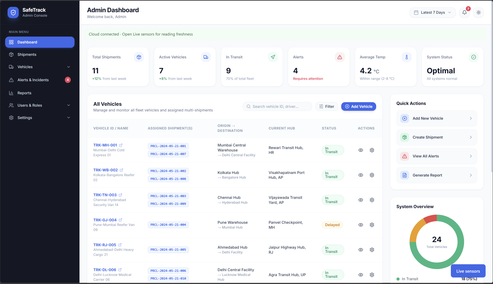
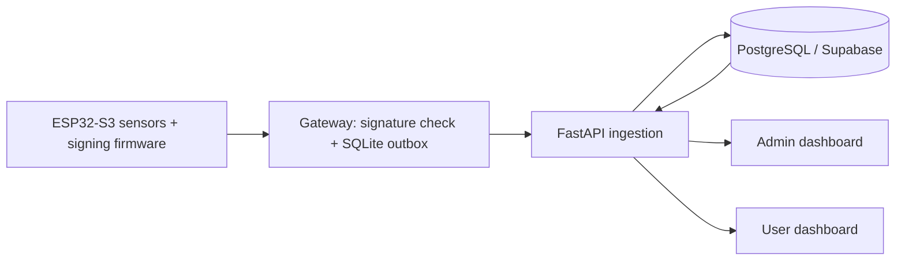

# SafeTrack

[](https://github.com/inamansingh2401/tamperproject/actions/workflows/regression.yml)

SafeTrack is a **team project** for shipment-condition monitoring, with ESP32-S3 sensing, ATECC508A-signed telemetry, a durable Python gateway and a PostgreSQL evidence ledger.



[Performance](#performance) · [Security](#security) · [Testing](#testing) · [Status and limitations](#status-and-limitations) · [Rollout](docs/ROLLOUT.md)

TrackSure is a shipment-security and condition-monitoring platform. It records environmental and motion data at the parcel, cryptographically signs each accepted record, preserves a hash-linked evidence trail, and presents the verified shipment state in separate Admin and User dashboards.

## Start here

```text
Sensors -> ESP32-S3 + ATECC508A -> Wi-Fi HTTP -> gateway verification
 -> SQLite outbox -> HTTPS API -> PostgreSQL ledger -> Admin/User dashboards
```

Use [firmware/tracksure_gateway/tracksure_gateway.ino](firmware/tracksure_gateway/tracksure_gateway.ino) for canonical Wi-Fi firmware. [tracksure_final_code.ino](tracksure_final_code.ino) is historical serial firmware. Current USB Serial use is development logs and flashing.

Device operation requires the connected peripherals, enrolled keys and private Wi-Fi/gateway configuration. Follow the [hardware runbook](LIVE_GATEWAY_RUNBOOK.md) and quick start below. To inspect software behavior independently:

```sh
python -m unittest discover -s tests -p "test_*.py"
node tests/test_evidence.cjs
node tests/test_ui_state.cjs
node tests/test_reports.cjs
```

## Contributions and team attribution

The canonical team repository is [inamansingh2401/tamperproject](https://github.com/inamansingh2401/tamperproject).

Abhishek Kumar Singh's stated contributions are end-to-end architecture, ESP32-S3 firmware, the Python gateway with SQLite outbox, FastAPI/PostgreSQL backend work, Render-to-Supabase recovery/migration work, and contributions to Admin/User dashboard design. These statements do not claim sole authorship of the platform or every later change. See the [shared commit history](https://github.com/inamansingh2401/tamperproject/commits/main).

## Deployment and acceptance scope

- Earlier battery-powered Wi-Fi/gateway/API/dashboard operation is documented. Latest buffering/enrollment firmware has software validation; its flashing and physical interruption/reboot acceptance remain deferred.
- Protected staged API validation is separate from promotion to the primary API alias. Later local work is not automatically part of that deployment.
- Render-to-Supabase recovery restored a historical SQLite snapshot. Newer Render-only history recovery is incomplete; a lossless transfer is not established.
- Signature enforcement depends on enrollment. Legacy compatibility and independent key/chain-anchor trust limits remain explicit.
- Remote regression CI has run. Historical notes record an initial frontend lockfile failure and correction. Consult the badge and [workflow history](https://github.com/inamansingh2401/tamperproject/actions/workflows/regression.yml) for subsequent outcomes.

## Live portal

[Open SafeTrack](https://safetrack-portal.vercel.app). One login routes administrators to the operations console and assigned users to their shipment dashboard. Request an account from the project operator; production credentials are not published.

Current hosted service status was not checked for this release; see the deployment history separately.

The shared login includes the truck introduction, optional sound replay, and a reduced-motion fallback. The user portal separates Overview, Conditions and Events; Conditions includes the sensor-driven 3D parcel. The admin Vehicles page supports fleet search, filtering and vehicle detail navigation.

## Why it exists

Shipment incidents such as unauthorised opening, abnormal movement, shock, or harmful environmental conditions are difficult to investigate when the sensor trail can be altered or cannot be tied to a device identity. SafeTrack provides timestamped device evidence, signature verification, and a per-shipment hash chain so that the stored history can be independently checked.

## Current implementation



The battery-powered firmware emits signed telemetry over Wi-Fi. The laptop gateway accepts it at `POST /ingest`, verifies the enrolled device and ATECC P-256 signature, persists the reading before acknowledging it, and retries HTTPS cloud delivery. The retained backend stores accepted events against their shipment, while the dashboards retrieve current telemetry separately from their historical ledger view. USB Serial remains available only for development logs and firmware flashing; it is not an event transport.

## Sensors and evidence fields

| Hardware | Purpose | Evidence captured |
|---|---|---|
| DHT11 | Shipment environment | Temperature and humidity |
| MPU6050 | Motion, tilt and shock | Accelerometer axes, gyroscope axes, shock flag, pitch and roll |
| LDR + 10 kΩ divider | Exposure/opening signal | Raw light ADC value and exposure state |
| ATECC508A | Device-backed identity | ECDSA signature over the telemetry envelope |

New evidence-version-2 events retain the original signed envelope (including boot/sequence metadata), normalized readings, enrollment public key when configured, SHA-256 chain references, gateway receipt time and backend arrival time. Older records remain readable but may lack original signatures; a stored hash alone is not evidence of a valid device signature.

### Reboot, reuse and evidence verification (local implementation, 14 October 2026)

- The canonical firmware commits up to 512 signed events to LittleFS before Wi-Fi delivery. Ordinary reboot resumes pending events unchanged; only a matching gateway ACK removes a record. Shipment assignment and pause state persist in NVS. Full/corrupt storage does not overwrite old evidence; recording gaps are possible when capacity is exhausted.
- The gateway now uploads every queued event in FIFO order and preserves the original envelope. Previously archived/blocked outbox records are not automatically replayed or changed. The backend keeps older gateway-receipt timestamps from replacing newer live telemetry.
- Admin shipment inspection includes device/public-key enrollment against an exact shipment. Bound devices cannot upload to another shipment. Legacy unbound devices retain compatibility until explicitly enrolled; complete enrollment before relying on cloud-side signature enforcement.
- Admin and user dashboards offer **Verify evidence** and a JSON export. The browser recomputes hashes, checks links, and verifies available P-256 signatures. `python Tamper_admin/backend/evidence.py <export.json>` verifies an export independently of the running API. Enrollment keys and chain anchors still need independent trust; this is not a blockchain or externally anchored ledger.
- See the [reboot/reuse workflow](LIVE_GATEWAY_RUNBOOK.md#5-reboot-and-device-reuse) and [prioritized improvement backlog](docs/IMPROVEMENTS.md).

Local software validation is summarized in the Testing section below. Hosted deployment and physical acceptance are not established by these phases; hardware signing performance remains unmeasured.

Additional local changes normalize seal labels, display UTC consistently, distinguish relative LDR readings from calibrated lux, mark unavailable MPU readings, preserve operational vehicle assignments on startup, and calculate report figures from stored data instead of placeholders. User dashboard logic has one canonical source; the build synchronizes its bundled copy. Gateway status exposes delivery/queue ages, worker availability and disk headroom. Read-only outbox inspection and a private PostgreSQL backup/restore drill are available; neither replays/deletes production history. See the backlog for partial and still-pending work; this is not an all-improvements-complete release.

## Security

Implemented controls include signed-device verification, explicit strict replay protection with retry-safe identities, admin-only registration/revocation/rotation, shipment hash-chain verification, request-field/body bounds, locked-down CORS, response headers and browser-role database isolation. Python runtime and frontend lock audits reported no known vulnerabilities after the documented patches; this is a point-in-time audit result.

Existing devices retain compatibility mode. Strict protection requires compatible firmware plus enrollment; it is not silently enabled. Historical signatures preserve their original public keys, while externally retained checkpoints are needed to detect deleted history suffixes. A compromised gateway can forge the current local ACK, and privileged operators can delete history.

See [the threat model, OWASP covered/partly/not-covered checklist and audits](docs/SECURITY.md), [local evidence](docs/benchmarks/verification.json), and [rollout guide](docs/ROLLOUT.md). Hardware signing and hosted policy behavior remain unverified. Existing login accounts, passwords and configured JWT secret are not changed by this documentation/benchmark update.

## Prototype scope and production roadmap

Future field deployments may add RTC-backed timing, SD-card evidence storage, network discovery and low-power operation. These remain roadmap capabilities.

The current prototype has been exercised while battery-powered through Wi-Fi, the laptop gateway, the existing HTTPS API, PostgreSQL, and the Vercel dashboard. It still depends on a manually started laptop gateway, local enrollment/configuration, a reachable 2.4 GHz network, and a LAN address that may change. It uses an **ATECC508A**, not an ATECC608A, and does not yet provide RTC time, SD-card recovery, deep sleep, or production operations/monitoring.

## Repository layout

- `firmware/tracksure_gateway` — ESP32-S3 firmware for the real device.
- `gateway` — Wi-Fi/LAN receiver, local signature verifier, durable uploader, and status endpoint.
- `Tamper_admin` — FastAPI backend, PostgreSQL model, API routes, and Admin dashboard.
- `Tamper_user` — shipment-user dashboard.
- `LIVE_GATEWAY_RUNBOOK.md` — flash, wiring, gateway, and production configuration instructions.

## Quick start with real hardware

1. Complete the supported wiring and flash the ESP32-S3 as described in [LIVE_GATEWAY_RUNBOOK.md](LIVE_GATEWAY_RUNBOOK.md).
2. Run the gateway:

   ```powershell
   cd gateway
   python -m pip install -r requirements.txt
   python gateway.py
   ```

3. Open `/status` on the configured gateway LAN address and port 8765. A working setup reports the latest accepted record as `sent` after cloud delivery succeeds.
4. Configure `DATABASE_URL`, `JWT_SECRET`, and `DEVICE_API_KEY` in the production API host. Load the matching existing device key into the gateway environment; JSON contains only a `device_key_env` reference. Follow the rollout guide without changing account passwords or JWT secrets.

For a dashboard-only local demo and its demo accounts, see [Tamper_admin/README.md](Tamper_admin/README.md). For the shipment-user interface, see [Tamper_user/README.md](Tamper_user/README.md).

## Hardware notes and limits

- Connect the ATECC508A and MPU6050 to the shared I2C bus: SDA GPIO 8 and SCL GPIO 9.
- The LDR requires a divider: `3V3 -> 10 kΩ resistor -> GPIO 4 -> LDR -> GND`. A missing resistor leaves GPIO 4 floating, so its readings are undefined.
- MPU6050 pitch and roll are gravity-derived and stable at rest. A magnetometer is required for absolute yaw; the dashboard therefore holds yaw stable.
- New firmware signs UTC capture time after SNTP synchronization; before synchronization it explicitly marks capture time unknown and keeps boot/uptime metadata. The backend distinguishes device generation, gateway receipt and backend arrival. SNTP is not authenticated or an RTC; offline reboot without synchronization cannot establish accurate generation UTC.

## Feasibility, impact, and future work

SafeTrack is built from low-cost, widely available embedded components and open protocols. The modular gateway lets a device operate during network interruptions and forward records after connectivity returns. The intended benefit is faster incident response, reduced disputes, and a verifiable chronological trail for asset owners, logistics operators, authorities, emergency responders, and investigators.

Next production steps include a stable gateway discovery/address strategy, battery and charging validation, RTC time synchronisation, SD-card recovery, hosted rollout of the implemented Alembic migrations, configurable alert thresholds, monitoring, and a magnetometer for absolute heading.

## Research and standards

- [NIST FIPS 180-4 — Secure Hash Standard](https://csrc.nist.gov/pubs/fips/180-4/upd1/final) for SHA-256.
- [Espressif ESP32-S3 documentation](https://docs.espressif.com/projects/esp-idf/en/latest/esp32s3/) for the device platform.
- [Microchip CryptoAuthentication devices](https://www.microchip.com/en-us/products/security-ics/cryptoauthentication) for secure-element integration.
- [NXP UM10204 — I2C-bus specification](https://www.nxp.com/docs/en/user-guide/UM10204.pdf) for shared sensor-bus design.

## Security and repository hygiene

The repository excludes local gateway configuration, device keys, database files, private keys, `.env` files, Vercel metadata, and build output. Never commit production credentials or cryptographic key material.

## Performance

All measurements below are local: synthetic PostgreSQL data, warm requests and software signatures where applicable. They do not measure hardware signing, hosted Supabase, WAN/TLS or browser rendering. Raw samples and methods are in [the benchmark index](docs/benchmarks/README.md).

### Read queries: five-run noise check

The SQL work removed N+1 loading, retained response semantics, paginated Alerts and added one plan-justified evidence index. Cells show median of five run percentiles; ranges and every run are in [the authoritative noise report](docs/benchmarks/phase1.md) and [raw summary](docs/benchmarks/noise/summary.json). Both latency columns are milliseconds.

| Route | p50 before → after | p95 before → after | SQL before → after | Outside observed noise? |
| --- | ---: | ---: | ---: | --- |
| Dashboard summary | 4.78 → 4.17 | 5.55 → 5.20 | 5 → 5 | No; ranges overlap |
| Vehicles | 4.50 → 4.24 | 5.06 → 4.87 | 2 → 2 | No; ranges overlap |
| Shipment list | 50.85 → 5.67 | 53.06 → 6.48 | 112 → 2 | Yes, both percentiles |
| Alerts, default page | 1038.96 → 4.51 | 1234.61 → 5.06 | 2980 → 2 | Yes, both percentiles; smaller response |
| Shipment detail | 6.59 → 7.07 | 7.92 → 8.12 | 6 → 6 | No; ranges overlap |
| Live telemetry | 3.27 → 3.48 | 4.44 → 4.22 | 3 → 3 | No; ranges overlap |
| Evidence page | 10.00 → 8.94 | 11.03 → 9.94 | 4 → 4 | No; ranges overlap |
| Reports summary | 45.08 → 17.06 | 116.70 → 18.60 | 9 → 8 | Yes, both percentiles |
| Alerts, complete history | 1038.96 → 61.27 | 1234.61 → 65.11 | 2980 → 12 | Yes, both percentiles |

Only the complete-history Alerts row is a like-for-like content comparison. Untouched Dashboard summary and Live telemetry have no established speedup. Reports serial-execution tuning was measured on this workstation and is unverified on hosted Supabase.

### Ingestion and batching

The completed Phase 3 five-run comparison at concurrency 10 measured single-event throughput of 75.95 events/sec [59.06, 93.51] versus ten-event batches at 141.45 [131.68, 160.19], with non-overlapping observed ranges. These are historical software-signed measurements before the Phase 4 controls, not current strict-device capacity. See [Phase 3 evidence](docs/benchmarks/phase3.md).

The final-code replay/auth comparison was stopped at the operator request after 36 cases, 14,400 timed events and zero timed errors. Only two complete rounds plus part of another were completed. Its five-run noise check and final overhead conclusion remain unfinished. [Partial results and scope](docs/benchmarks/final-ingestion.md) must not be used as a final speedup or capacity claim.

Final replay/authentication timing overhead is not established by the incomplete experiment. Historical Phase 3 rates are labeled separately.

### Optional Reports cache

**Caching is OFF by default and remains OFF for this release.** Only Reports has an opt-in cache. Alerts and live data stay uncached. In the local polling mix, caching avoided 300 report SQL calls (960 → 660); high churn produced no hits and increased report SQL calls (960 → 1,080). These deterministic query counts support the trade-off; the separate single-pair cache timing experiments do not establish a repeatable latency gain. See [cache evidence and freshness rules](docs/benchmarks/phase2.md).

## Testing

Run from the repository root. Tests create isolated SQLite/disposable loopback PostgreSQL databases and generated process-only credentials. They do not reset existing accounts or touch the running API. Use the unchanged login credentials for existing deployments; bootstrap password settings are for initial provisioning, not password rotation.

```powershell
python -m pip install -r Tamper_admin/backend/requirements.txt httpx
python -m unittest discover -s tests -p "test_*.py"
python operations/run_postgres_tests.py
node tests/test_reports.cjs
node tests/test_evidence.cjs
node tests/test_ui_state.cjs
node tests/test_alert_pagination.cjs
pnpm --dir Tamper_admin/frontend install --frozen-lockfile
pnpm --dir Tamper_admin/frontend build
```

Current counts: 59 PostgreSQL tests passed; SQLite passed 57 with two PostgreSQL-only skips; all four browser logic scripts and the frontend build passed. Evidence and exact runtime versions: [verification manifest](docs/benchmarks/verification.json). The browser scripts run under Node/WebCrypto; they are not hosted-browser or hardware acceptance tests.

## Status and limitations

| Area | Status | Meaning |
| --- | --- | --- |
| Read-query and ingestion measurements | Verified locally | Synthetic 100k-event PostgreSQL seed; software-signed ingest; repeated runs and observed noise only. |
| Replay, device lifecycle, hash-chain verifier, request limits and browser-role isolation | Implemented server-side and locally tested | Migration, environment configuration and enrollment are still required on the target deployment. |
| Existing devices | Compatibility mode | Keep running with their current firmware/credentials until deliberately updated and enrolled; compatibility mode does not provide full strict replay protection. |
| New/enrolled strict devices | Full implemented strict-device controls | Requires compatible signed epoch/counter/timestamp fields and explicit enrollment. This is not proof of physical sensor truth. |
| ATECC508A hardware signing | NOT yet verified here | Hardware signing performance, provisioning and power-loss behavior are unmeasured. |
| Hosted Supabase behavior | NOT yet verified | No hosted database operation, policy test, capacity test or deployment was performed for these phases. |
| Firmware epoch and ACK changes | NOT yet verified / pending | Key epochs, per-item batch ACKs and authenticated custody ACKs remain necessary; persistent boot counting still needs physical acceptance. |
| Evidence retention | Limited | A malicious admin/database owner can erase history. Detecting a deleted suffix requires an independently retained checkpoint. |
| Gateway trust | Limited | Existing local ACKs can be forged by an active network attacker or compromised gateway. |
| Reports cache | Opt-in, OFF | Helps repeated polling in query counts; hurts high-churn reads. Redis performance is unmeasured. |

See [architecture and scaling assumptions](docs/ARCHITECTURE.md), [security coverage and OWASP checklist](docs/SECURITY.md), [Phases 0–4 changelog](docs/CHANGELOG.md), and [the ordered rollout/rollback guide](docs/ROLLOUT.md). Do not describe the deployed system as secured: these are implemented controls with explicit unverified boundaries.

## License

This repository is a project prototype. Add an explicit license before redistributing it outside the team.

## Deployment and validation

See [Deployment guide](docs/DEPLOYMENT.md), [release notes](docs/RELEASE_NOTES.md), and [shared portal architecture](Tamper_admin/frontend/SHARED_PORTAL.md).
