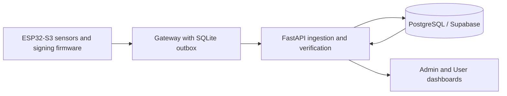

# SafeTrack — updates and current status

SafeTrack is a team shipment-monitoring project connecting ESP32-S3 sensors, signing firmware, a durable gateway, FastAPI, PostgreSQL and Admin/User dashboards. This file summarizes the local improvements; the [main README](README.md) retains the project overview, screenshot and team attribution.

**Source publication and production deployment are separate. Hosted migrations and production acceptance have not been performed by this work. Existing login accounts, passwords and JWT secrets have not been changed.**

## System architecture



## What changed

| Area | Implemented changes |
| --- | --- |
| Baseline | Deterministic synthetic PostgreSQL seed, endpoint benchmarks, SQL call counts and query plans. |
| SQL performance | Removed Alerts/Shipment list N+1 queries; added alert cursor pagination, Reports aggregation and a plan-justified evidence index with Alembic migrations. |
| Caching | Optional Reports cache, transactional invalidation and hit/miss metrics. **OFF by default.** Alerts and live telemetry remain uncached. |
| Ingestion | Bounded batches, idempotent retries and per-device/IP limits; authenticated critical events bypass ordinary telemetry quotas. |
| Security | Explicit strict-device replay protection, registration/revocation/rotation, stored-chain verification, bounded request parsing, CORS/headers, environment-only gateway credentials and browser-role isolation SQL. |
| Documentation | Architecture, threat model, OWASP checklist, measured reports, changelog and ordered rollout/rollback instructions. |

Existing devices remain in compatibility mode until compatible firmware and explicit strict enrollment are ready. Assignment-only public-key binding does not activate strict replay protection. New strict registrations require the signed epoch/counter/timestamp fields.

## Measured results and verification

- Read-performance claims use the [completed five-run noise check](docs/benchmarks/phase1.md). Alerts default-page SQL calls fell from 2,980 to two; complete-history traversal uses 12. Shipment listing fell from 112 to two. Default-page Alerts returns less data, so use complete history for a like-for-like comparison.
- The [completed historical Phase 3 comparison](docs/benchmarks/phase3.md) measured 75.95 events/sec for single requests versus 141.45 for ten-event batches at concurrency 10, with non-overlapping run ranges. This predates strict replay protection and is not final-code capacity.
- The [final-code experiment](docs/benchmarks/final-ingestion.md) stopped incomplete after 36 cases and 14,400 timed events, with zero timed request errors. It does **not** establish a final five-run throughput or security-overhead claim.
- Latest full local checks passed: **59 PostgreSQL tests; 57 SQLite tests with two PostgreSQL-only skips; four browser logic scripts; frontend build**. See [verification evidence](docs/benchmarks/verification.json), including the post-merge checks.
- Archived installed-runtime and frontend-lock audits reported no known vulnerabilities at audit time. This is not proof that no vulnerabilities exist. Details are in [SECURITY.md](docs/SECURITY.md).

All performance measurements are local and synthetic. Signed-request tests use software P-256 keys. Cache polling avoided database calls in its measured mix, while high churn added calls without hits; its separate timing diagnostics were not five-run validated gains. See [cache evidence](docs/benchmarks/phase2.md).

## Status and limitations

| Area | Status |
| --- | --- |
| Local software behavior | Tested against SQLite and disposable PostgreSQL; browser logic and frontend build passed. |
| Server-side controls | Implemented locally; target migrations/configuration/enrollment remain prerequisites for deployment. |
| Existing devices | Compatibility mode continues until deliberate firmware update and strict enrollment. |
| ATECC508A signing performance | Unmeasured here; software signatures do not establish hardware performance or provisioning security. |
| Hosted Supabase behavior | Unverified; database operations were explicitly declined and none were performed. |
| Firmware epoch/ACK changes | Pending, including per-item batch acknowledgments and authenticated custody acknowledgments. |
| Evidence completeness | Detecting deleted history suffixes requires an independently retained checkpoint. Privileged operators can erase history. |
| Gateway trust | Current local acknowledgments can be forged by a compromised gateway or active network attacker. |
| Deployment | Not performed; do not publish the new backend before its schema/configuration prerequisites are approved and ready. |

## Reproduce local verification

Run from the repository root with the documented dependencies and local PostgreSQL installed:

```powershell
python -m unittest discover -s tests -p "test_*.py"
python operations/run_postgres_tests.py
node tests/test_reports.cjs
node tests/test_evidence.cjs
node tests/test_ui_state.cjs
node tests/test_alert_pagination.cjs
pnpm --dir Tamper_admin/frontend install --frozen-lockfile
pnpm --dir Tamper_admin/frontend build
```

The test configuration uses isolated databases and generated test credentials. Do not substitute a hosted database into the test commands.

## Next steps

Use the [ordered rollout guide](docs/ROLLOUT.md) only after hosted database work is authorized: backup, reviewed migrations, gateway environment credentials, compatible device enrollment, deliberate deployment and operator verification. Preserve current account/password/JWT settings. Complete the ingestion experiment before claiming final strict-device capacity or overhead.

More detail: [changelog](docs/CHANGELOG.md), [architecture](docs/ARCHITECTURE.md), [security model](docs/SECURITY.md), [benchmark index](docs/benchmarks/README.md). Credit shared work to the original team contributors and use Git history when describing personal contributions.
