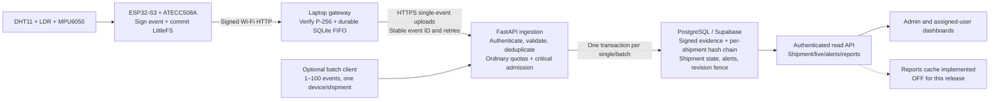

# SafeTrack architecture and measured capacity

This document describes the Phase 3 API and its existing hardware/gateway path. Measurements are local software tests. Hosted Render/Supabase performance, physical ESP32 timing, fleet Wi-Fi capacity and end-to-end alarm-delivery latency remain unmeasured. Application caching stays off.

The measured lab used cryptography 50.0.1, outside the repo's declared <47 constraint. Identical lab dependencies were used within each paired comparison. The declared dependency range was separately tested for behavior, but its ingestion performance was not measured. Treat the capacity extrapolations as lab observations, not deployment sizing guarantees.

## Device, gateway and evidence boundaries

The ESP32 signs exact event bytes and commits them before LAN delivery. Its LittleFS queue holds up to 512 records. At the configured one-second frame interval, that is about 8.5 minutes of queued frames when the gateway cannot accept them, assuming every sampling opportunity produces an event. This is a calculation from code limits, not a measured battery/offline guarantee. Full or corrupt storage stops recording new events without overwriting retained evidence, so gaps remain possible.

The gateway acknowledges only after signature verification and a durable SQLite commit. The device removes only the matching acknowledged record. Once accepted locally, cloud outages grow the gateway's disk outbox while the device can continue using the local link. The current gateway configuration binds one device and one shipment. It has not been converted into a multi-device gateway. Scaling to thousands of devices needs a gateway enrollment/routing design in addition to API capacity.

That describes honest-gateway behavior: the current local acknowledgment is not authenticated, so an active network attacker or compromised gateway can forge it and induce device queue deletion. Cloud signature checks do not fix that custody gap. See [the security model and remaining firmware work](SECURITY.md).

The gateway has a single FIFO uploader. Transient network failures, 408, 429 and 5xx responses retain the original event and schedule retries. Permanent configuration/enrollment failures are blocked for diagnosis. Archived history is not replayed automatically. Backlog survives software restart when the original outbox is retained. A free cloud host's ephemeral filesystem is unsuitable for this custody boundary.

FastAPI verifies the credential and an enrolled device's P-256 signature before accepting data. The device and shipment row locks serialize conflicting writes. Unique event IDs and the original payload digest make identical retries acknowledge the existing record; changed identity/readings conflict. A batch holds one device/shipment pair, preserving the relative order of accepted records within its transaction.

Hash-chain order is database insertion order. Displayed latest state uses capture/gateway time so delayed events cannot replace newer telemetry. Signed capture UTC depends on the device's clock. SNTP and unsigned gateway fallback time are not independent proof of accurate UTC. Enrollment keys and chain anchors require independent trust, and the system still has no external tail anchor.

Phase 4 adds opt-in `counter_v1` devices: signed key epoch/boot counter/sequence and a transactional replay ledger, with bounded reordering and capture-age acceptance. Identical committed retries still return the original receipt; revocation/authentication remain enforced. Existing devices stay legacy until firmware/enrollment is ready. The additional write/storage cost is unmeasured; the following Phase 3 throughput results do not measure this stricter path. Gateway upload credentials now come from environment variables; see [rollout steps](security/rollout.md).

## Write-path measurements

The [Phase 3 benchmark report](benchmarks/phase3.md) contains every run, p50/p95, SQL counts and error rates. Five revision-enabled/bypass pairs were measured at concurrency 1, 5, 10 and 20, against fresh 100k-event seeds. These are finite closed-loop bursts over loopback HTTP, not a hosted service SLA or a sustained fleet test.

The revision-enabled median rates at concurrency 1/5/10/20 were 69.3, 89.8, 82.8, 80.2 events/sec. At concurrency 10, ten-event batching raised median throughput from 76.0 to 141.5 events/sec, with non-overlapping observed ranges. All completed timed capacity cases had zero request errors.

The revision-enabled and bypass ranges overlap at every tested concurrency. One extra SQL statement per single-event commit is measurable, but the experiment does not establish a shared-revision-row bottleneck outside workstation noise. The fence remains enabled in production code despite caching being off, preserving cross-worker invalidation correctness.

The API uses a pool of five database connections plus five overflow connections. Extra concurrency can queue for those connections, and same-device/same-shipment writes are serialized. CPU, pool waits, database lock waits and filesystem/WAL latency were not isolated. No pool-size or speculative index change was made.

## What 1,000 and 10,000 devices imply

The firmware's one-frame/sec cadence implies offered loads of 1,000 and 10,000 events/sec. Neither rate was demonstrated by the measured local process. Queue growth occurs if arrival rate exceeds actual service rate. Increasing client concurrency alone did not demonstrate either fleet size. The hosted API/database network adds an unmeasured component, and simultaneous dashboard reads were not included in these write benchmarks.

Using the batch sample, the median relation allocation increase was 1,679,360 bytes per 400 events, or 4,198.4 bytes/event.

| Devices | Assumed event cadence | Offered events/sec | Required new events/day | Illustrative relation growth/day |
| ---: | --- | ---: | ---: | ---: |
| 1,000 | One per 1 seconds/device | 1,000.00 | 86,400,000 | 362.74 GB |
| 10,000 | One per 1 seconds/device | 10,000.00 | 864,000,000 | 3,627.42 GB |
| 1,000 | One per 60 seconds/device | 16.67 | 1,440,000 | 6.05 GB |
| 10,000 | One per 60 seconds/device | 166.67 | 14,400,000 | 60.46 GB |

All fleet rates and daily counts in that table are arithmetic extrapolations, not executed load tests. The relation-growth estimate uses the five-run batch sample's median sensor_events allocation increase, including its indexes and TOAST. It covers a short append burst and can include dead versions before vacuum; it excludes other tables, WAL and backups. Payloads used signed minimal temperature/humidity/LDR frames. Optional full motion-vector payload costs and long-term storage density were not measured. The estimates are planning illustrations rather than a storage bill or retention guarantee.

For 1,000 devices, the existing one-device gateway configuration, finite buffers, write capacity and storage retention all need redesign/validation. For 10,000 devices, the same constraints are larger, and per-shipment serialization, connection budgets, ingestion distribution and operational monitoring become deployment concerns. A distributed queue, partitioning, stronger timekeeping and evidence-preserving archival are possible future work. They were not implemented in this phase.

At 10,000 one-Hz devices behind one IP, the default ordinary-IP budget would also throttle ordinary traffic even if more compute were available. Critical admission still bypasses that quota. It does not reserve a separate worker pool or database connection.

Dashboard polling adds load independently of device count. Current live reads use three SQL statements including authentication. The read benchmarks do not establish how many active users can poll while the write path is saturated.

## Retry, batch and alarm policy

Single events may carry Idempotency-Key matching the signed event_id. Header-only identity is supported for compatible legacy unsigned producers. Clients without either stable identity form keep legacy behavior and have no duplicate protection guarantee.

The batch endpoint accepts 1–100 events for one device/shipment. Future clients should send new critical records immediately rather than wait to fill a backfill batch. Valid accepted records share one commit/revision update. A quota-limited item gets a per-item 429 without preventing later authenticated critical records from being evaluated. Mixed quota outcomes return 207. Retry denied IDs unchanged and never delete gateway records based only on the batch's overall HTTP success.

Ordinary device/IP token buckets are process-local. Defaults permit the current one-Hz stream and an ordinary burst. Authenticated critical light/shock/heat records bypass those quotas. Failed credentials have a separate IP budget, so an invalid caller does not spend a legitimate producer's budget. Deployment proxy trust must be configured correctly for ASGI client IPs.

This is admission control, not guaranteed emergency delivery under a network outage or compute exhaustion. Legacy credential-only devices retain compatibility, so hardware-backed trust requires completing public-key enrollment. Compromised authenticated devices can still flood the critical lane. Gateway FIFO backlog can also delay delivery. These limits are explicit rather than hidden behind an alarm-delivery promise.

## Current free-tier and cost boundaries

Provider limits were checked against public documentation on 8 November 2026. No hosted account or database was queried.

Render publishes 750 free instance-hours per workspace/month, spins a free web service down after 15 idle minutes, and limits free web services to one instance with ephemeral local storage. Free Render PostgreSQL expires after 30 days and is unsuitable as the long-term evidence store here. These constraints support a prototype cost floor of zero within allowances, not a fleet availability commitment. [Render free-service documentation](https://render.com/docs/free).

Supabase advertises a free 500 MB database and 5 GB egress allowance, with shared compute and inactivity pausing. Its published Pro plan starts at $25/month. API request allowance is not an ingestion-throughput guarantee. SafeTrack uses its own JWT/API layer and SQL connection, so Supabase Auth user quotas do not translate into device capacity. [Supabase pricing](https://supabase.com/pricing).

At the extrapolated retention demand above, a free database cannot be assumed to retain an indefinite signed-event history. Archival must preserve original signed envelopes and trusted chain continuity. Paid compute, egress, backup, retention and gateway costs require actual hosted measurements and a retention policy. No total paid-cloud bill or cloud cost saving is claimed.

Render can also suspend free services for unusually high service-initiated internet traffic, including external database access. Render-to-Supabase traffic and Supabase egress have not been measured here. Local ingestion events/sec cannot establish either allowance's remaining capacity. [Render service-initiated traffic limits](https://render.com/docs/free#service-initiated-traffic-threshold).

## Deployment and verification

Keep REPORT_CACHE_BACKEND=off on every API worker. The Phase 3 endpoints require no additional migration beyond the reviewed Phase 1/2 schema. Deploy the API, retain normal single-event gateway operation and verify a signed upload, duplicate retry, ordinary 429 and authenticated critical upload.

Only adopt batch clients after implementing per-item acknowledgment and Retry-After handling. No ESP32 firmware change, gateway batching switch, hosted deployment or hosted benchmark was performed. The 35 existing tests are retained alongside new retry, batch and rate-limit tests. [Safe Supabase migration/backup instructions](SUPABASE_ROLLOUT.md).
